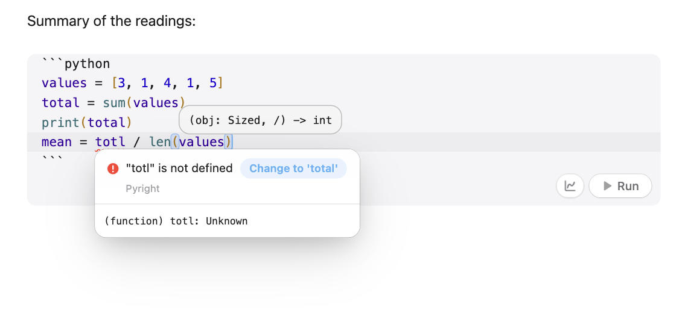

# Tahoe Code

**An IDE in your code blocks.** Smart Enter and indentation, closing brackets, suggestions as you type, live templates, coloured brackets, sticky headers and go to definition, in every code block of your notes. On desktop it also checks your code as you type, offers quick fixes, talks to language servers, formats, and edits with a local AI model. Text outside code blocks is left alone.



- Type `tot` and **`total`** is suggested; `xs.for` + Tab becomes a whole `for` loop.
- A misspelt name is **underlined as you pause**; its card offers **Change to 'total'**.
- **⌘-click** a name to jump to where it's defined; in a long block, the `def` you're in **stays pinned** at the top.

Every feature has a switch in the settings.

## Typing

- **Smart Enter.** The new line is indented after `:` in Python, `{`, `then`/`do` in the shell and `if`/`for`/`function` in MATLAB, Ruby, Lua and Julia. Between brackets, Enter opens the pair onto its own lines. `else:`, `}` and `end` move back a level as you type them.
- **Brackets and quotes** close themselves and are typed over; selected text gets wrapped; Python gets `"""` docstrings. Enter after `if x` in MATLAB adds the `end` (and `fi`/`done` in the shell, `end` in Ruby, Lua and Julia).
- **Indent.** Tab and ⇧Tab indent and outdent by the block's own unit (2, 3 or 4 spaces, or tabs). Backspace in leading space removes a whole level.
- **⌘/** comments lines with the language's own marker: `#`, `%`, `//`, `--`.

| Keys | Does |
| --- | --- |
| ⌥↑ / ⌥↓ | Move the line or the selected lines, within the block |
| ⌘D | Duplicate the line or the selection (in code blocks) |
| ⌃G | Select the next occurrence of the word, to type in several places |
| ⇧F6 | Rename a name everywhere in the block |
| ⌘B or ⌘-click | Go to where a name is defined (on the definition: its next use) |
| ⇧⌥F | Format the block (desktop) |
| ⌥↩ | Quick fixes for the problem on the line (desktop) |
| ⌘I | Describe a change; a local model makes it (desktop) |
| ⌘I in an equation | Write it as a function, with a quick check (desktop) |

On Windows and Linux, ⌘ is Ctrl.

## Seeing the code

- Indent guides, a highlighted current line, brackets coloured by depth, and the matching bracket marked (a stray one in red). Line numbers per block are optional.
- **Uses of a name.** With the cursor on a name, every use in the note's blocks of that language is highlighted.
- **Sticky headers.** In a long block, the lines that opened where you are (`class …:`, `def …:`, `for … {`) stay pinned at the top, up to three deep. Click one to go there.
- **Folding**, with the fold arrows in their own column.

## Suggestions

- **As you type**, without pressing anything. Matching is fuzzy and understands camel humps (`gTN` finds `getTotalNumber`), but the first letter has to match. Where you're naming something new (`import numpy as np`, `def area(width`, `int count`) no list appears. Enter takes a suggestion only when it starts with what you typed; Tab always takes it. Names come from the block, the note's other blocks of the same language and the language's keywords; what you pick often moves up.
- **Live templates.** `fori`, `main`, `psvm`, `sout`, `def`, `cls`, `func`, `iferr`, `plt`… then Tab, and Tab again through the blanks. About twenty languages, and you can add your own.
- **Postfix.** `xs.for` becomes `for item in xs:`; `cond.if`, `x.not`, `len(xs).print`, `x.var`, `items.log`, `A.disp` work the same way, per language.

## On desktop

- **Check while you type.** When you pause, problems are underlined; hover one to read it. Python, MATLAB (MATLAB's own checker), C, C++, Objective-C, Swift, JavaScript, Java, Ruby, Perl and the shell, with the tools you have. Notebook noise like MATLAB's "add a semicolon" is left out.
- **Quick fixes (⌥↩).** *Change to 'total'* for a misspelt name, *Add import numpy as np* for `np`, `pd`, `plt`, `Path`, `defaultdict` and more; clang's and clangd's fix-its in C, C++ and Objective-C; a missing `;` in Java. The problem's card has them as buttons too.
- **Language servers.** Typed completions, docs on hover, parameter hints and problems from clangd and SourceKit (with Xcode's tools), Pyright or pylsp, typescript-language-server, gopls and MathWorks' MATLAB language server, whichever you install. Pyright is tuned for notes: redefining a name in a later block isn't flagged.
- **Format with ⇧⌥F** using clang-format, swift-format, ruff or black, gofmt, rustfmt, shfmt or stylua, whichever is installed; otherwise it tidies the indentation.
- **⌘I to edit with AI.** Describe a change ("vectorise this loop") and a local model rewrites the selection or the block. The change shows as a diff; ⌘↩ keeps it, Esc throws it away.
- **Equation to code.** In a `$$ … $$` or `$ … $` equation, ⌘I writes it as a Python, MATLAB, Julia or C++ function, named after your notes, with a quick check against the formula written out with loops. With Tahoe Run, the check runs straight away, and a failure goes back to the model once.
- **Ghost text.** When you pause at the end of a line, a local model's suggestion appears in grey; Tab takes it. Short and code only.

The AI features use [Ollama](https://ollama.com) on your computer (a small coding model such as `qwen2.5-coder:1.5b` is enough for ghost text; ⌘I prefers 7B or more), or Apple Intelligence through Tahoe Intelligence.

Developed and tested on macOS; the desktop tools are written for Windows and Linux too, but that's untested. On phones and tablets, everything above *On desktop* works.

<!-- tahoe-family -->
## The Tahoe family

Tahoe is a set of plugins and a theme that work on their own and fit together.

| | | |
| --- | --- | --- |
| **[Tahoe Run](https://github.com/krishnanefx/obsidian-tahoe-run)** | Run the code in your notes, like a notebook: Python with a debugger and variables view, MATLAB, and ~25 other languages. | available |
| **[Tahoe Math](https://github.com/krishnanefx/obsidian-tahoe-math)** | A calculator in your notes: type an expression ending in `=` and the answer appears. | available |
| **[Tahoe](https://github.com/krishnanefx/obsidian-tahoe-theme)** | A clean, Mac-like theme, in light and dark. | available |
| **Tahoe Code** | An IDE in your code blocks: suggestions, checking as you type, quick fixes, go to definition, formatting and AI edits. | this one |
| **[Tahoe Glass](https://github.com/krishnanefx/obsidian-tahoe-glass)** | Real refraction for the Tahoe theme's glass, and header cards on settings pages. | available |
| **[Tahoe Organize](https://github.com/krishnanefx/obsidian-tahoe-organize)** | Keep a growing vault tidy: inbox triage, smart folders, colored tags, link suggestions, vault health, literature notes and text from images. | available |
| **[Tahoe Intelligence](https://github.com/krishnanefx/obsidian-tahoe-intelligence)** | On-device AI for your notes: ask your notes, related notes, distilling permanent notes and more. | available |

**Better together**

- **With [Tahoe Run](https://github.com/krishnanefx/obsidian-tahoe-run):** Python and MATLAB suggestions come from the note's running session (a data frame's real columns, a struct's fields), and equation to code runs its quick check straight away.
- **With [Tahoe Intelligence](https://github.com/krishnanefx/obsidian-tahoe-intelligence):** Apple Intelligence can be the model for ghost text, ⌘I and equation to code, on your Mac, if you don't use Ollama.
- **With [Tahoe](https://github.com/krishnanefx/obsidian-tahoe-theme):** suggestion lists, hover docs and problem cards appear as solid, readable cards with the theme's corners.
<!-- /tahoe-family -->

## Disclosures

- **It runs programs on your computer** (desktop only), when they're installed: checkers and compilers to find problems (Python, clang, swiftc, javac, node, ruby, perl, the shell, MATLAB's checker), formatters when you press ⇧⌥F, and language servers while you edit a block in their language. Only run code and tools you trust.
- **Network use:** only to Ollama on your own computer (localhost:11434), for ghost text, ⌘I and equation to code. Nothing is sent to the internet.
- **Files outside your vault:** code is written to temporary files in your system's temp folder to check or format it. To find MATLAB, it looks in your Applications folder.
- **No telemetry, ads, accounts or payments.**

## Credits

Tahoe Code is an independent project. It isn't affiliated with, or endorsed by, Apple, MathWorks or JetBrains.

## License

[MIT](LICENSE) © 2026 Krishnan Adaikkappan

## Building from source

```sh
npm ci
npm run build     # writes main.js
```

Releases are built by GitHub Actions: push a tag that matches the version in `manifest.json`, then publish the draft release it creates.

Other plugins can add suggestions through `app.plugins.plugins["tahoe-code"].api.registerCompletionProvider(…)`; Tahoe Run uses it for its running sessions.
